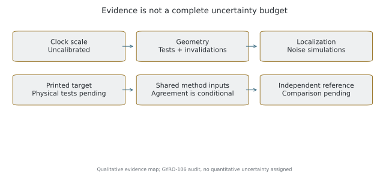
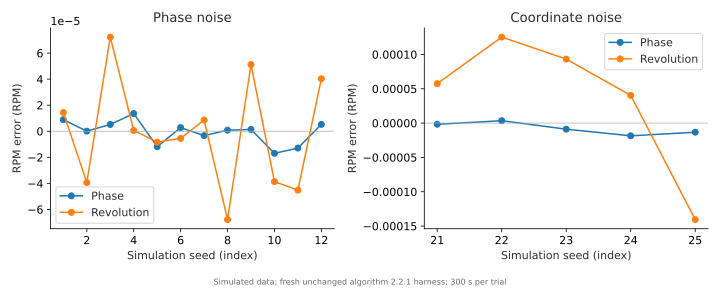
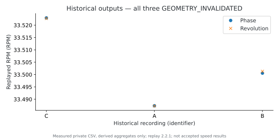
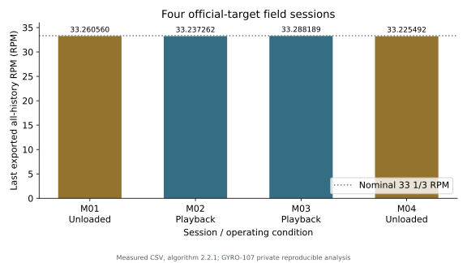
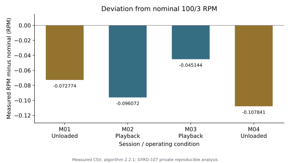
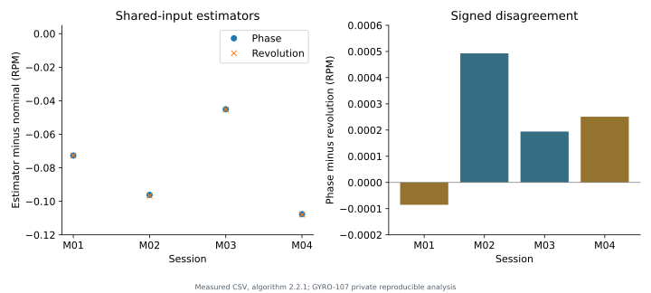
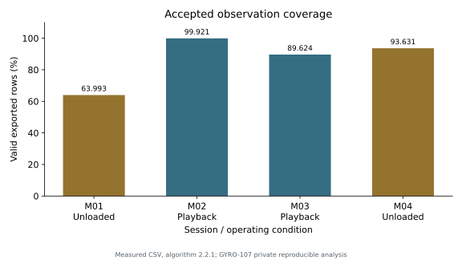
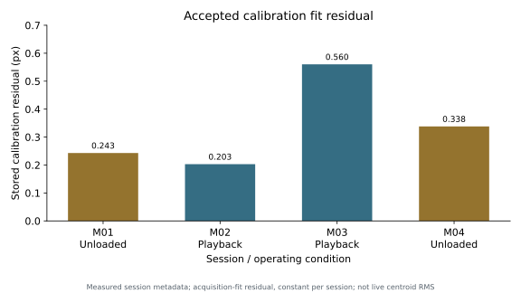
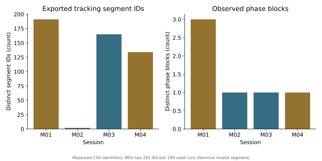
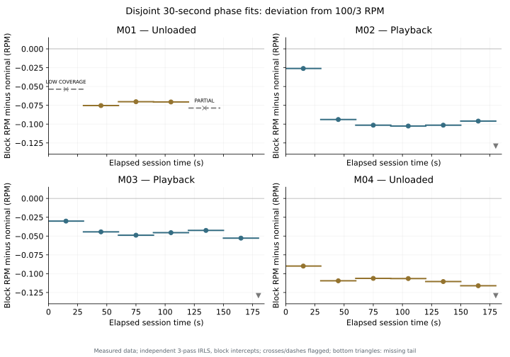

# Accuracy, Uncertainty and Validation

**Baseline:** application `1.0.0-stage1b` (version code 10), algorithm `2.2.1`; verified 2026-11-05. This paper distinguishes fresh numerical tests, historical recordings and experiments still required. See [methodology](measurement-methodology.md) for estimators and [evidence](publication-evidence.md) for conditions and outputs.

## 1. Terminology

| Term | Meaning here |
| --- | --- |
| Resolution | Smallest displayed or stored increment, not an error bound |
| Precision | Dispersion under specified conditions |
| Repeatability | Precision under substantially unchanged procedure and conditions |
| Reproducibility | Precision when declared conditions, such as device or operator, change |
| Random error | Unpredictable observation-to-observation variation |
| Systematic error | Persistent or predictably varying bias, such as clock scale |
| Statistical uncertainty | Estimated variation conditional on a statistical model |
| Confidence interval | A procedure with stated repeated-sampling coverage under assumptions |
| Absolute accuracy | Closeness to a reference, not established by internal agreement |
| Calibration | Establishing a relationship to reference values with uncertainties |

Storing 33.522927 RPM does not imply micro-RPM accuracy. A fitted-slope interval is conditional on data, geometry and timebase, not automatically a whole-instrument uncertainty budget. See [JCGM publications](https://www.bipm.org/en/committees/jc/jcgm/publications) and [NIST terminology](https://www.nist.gov/pml/nist-technical-note-1297/nist-tn-1297-appendix-d1-terminology).

## 2. Error sources

| Source | Mechanism | Evidence and limitation |
| --- | --- | --- |
| Timestamps | Random jitter; systematic clock-scale bias | Simulations completed; physical clock calibration absent |
| Localization | Centroid noise and photometric bias | Coordinate-noise tests; real bias budget absent |
| Geometry | Wrong centre/axes cause periodic phase distortion | Synthetic tests and historical invalidations; no complete perspective/lens budget |
| Frame loss | Reduced coverage and unknown lost cycles | Drop simulations; no universal device tolerance |
| Phase | Incorrect turn count corrupts timing | Discontinuity checks; ambiguous blocks excluded |
| Regression | Constant-speed model, outlier influence and sampling bias | Numerical tests; arbitrary motion not covered |
| Drift | Genuine speed changes during the window | Replay drift indications; physical cause not isolated from optical errors |
| Target | Warp, contrast, shadows and eccentric mounting | PDF/image tests and four initial physical sessions; broader printer/device acceptance incomplete |
| Camera | Exposure, resolution, stabilization, rolling shutter | Metadata audit; device-specific systematic budget absent |



*Figure 8. Qualitative evidence status, not a quantified uncertainty budget.*

Unmeasured terms must not be assigned zero. A physical uncertainty budget needs statistical and other evaluated contributions; see [NIST uncertainty basics](https://physics.nist.gov/cuu/Uncertainty/basic.html).

## 3. Phase uncertainty implementation

The robust phase fit is described in the methodology. Uncertainty takes the larger of two variance estimates rather than treating each video frame as an independent experiment.

Eligible non-overlapping five-second blocks provide ordinary-least-squares slopes, each requiring at least 12 observations and 3.5 s span. For m block RPMs, centred values z_j and L = min(m−1, ceil(m^(1/4))):

```text
M = Σ z_j² + 2 Σ[l=1..L] (1−l/(L+1)) max(0, Σ z_j z_(j−l))
SE_blocks = sqrt(M / (m(m−1)))
```

Negative lag covariance is clipped to zero. This is a conservative HAC-style modification, not a guarantee that all correlation is captured.

One-second clusters also accumulate slope scores S_c = Σ w_i x_i e_i, with block-centred time x_i, residual e_i and Sxx = Σ w_i x_i²:

```text
SE_clusters = sqrt(Σ S_c²) / Sxx × 60/(2π)
U95_phase = max(10⁻¹⁰ RPM, t95(m) × max(SE_blocks, SE_clusters))
```

`t95` is the implementation's conservative grouped Student lookup indexed by block count, not an exact continuously evaluated quantile. Fewer than two blocks yields no interval; reliable-window status needs at least three blocks, adequate duration/coverage and bounded residuals. Block count is a correlation safeguard, not a measured count of independent physical trials. Longer correlation and nonstationarity remain limitations.

The nominal 95% half-width is conditional on this model. The numerical floor is not a physical accuracy floor. A short window may yield an RPM before it supports meaningful uncertainty; missing uncertainty must not be displayed as zero.

## 4. Revolution Timing uncertainty

With interpolation fraction f and local rate v = |Δθ/Δt|, phase-noise propagation is:

```text
σ_t = sqrt(((1−f)σ_a)² + (f σ_b)²) / v
```

This assumes locally linear phase. It does not include calibrated clock uncertainty, every exposure effect or arbitrary acceleration error.

The robust time-versus-index regression uses within-group centred indices. Its HAC variance accumulates weighted index-residual scores with triangular weights through ceil(N^(1/4)) lags, excluding cross-group pairs. Unlike the phase block formula, signed lag contributions are retained. Final variance is floored at zero and at propagated crossing variance Σ x_k² σ_tk² / Sxx². For period standard error SE_T:

```text
U95_revolution = t_multiplier × 60 × SE_T / T_hat²
```

The helper receives N−G (events minus eligible groups), uses that argument minus one for its conservative Student lookup and requires N−G ≥ 5. Shared observations, geometry and clock errors correlate crossings. More turns constrain the period, but do not calibrate it. Very narrow synthetic intervals can simply reflect missing systematic terms in a simulator.

## 5. Agreement and drift

The application-native difference is Revolution Timing minus Phase Regression. The new field table below explicitly uses the requested opposite convention, Phase minus Revolution; its sign must not be confused with the CSV `rpm_difference` field. Phase comparison uses supported crossing intervals. Comparison blocks default to 30 s and require at least 90% span. At least three paired blocks support the 99% paired-difference limit, using triangular lag weights and non-negative covariance contributions. Drift assessment uses leverage-adjusted slope scores, a HAC term and an ordinary-regression variance floor.

Invalid geometry, inadequate coverage, ambiguous phase, drift or common bias can defeat the interpretation of agreement. A fresh simulation with true 33.52 RPM and elapsed timestamps multiplied by 1.0005 gives **33.503248376 RPM in both methods**. Their difference is below 10⁻¹⁰ RPM while both have about −0.016752 RPM error. Agreement does not independently verify the camera clock.

## 6. Fresh synthetic validation

Unchanged production measurement and tracking classes were compiled into a private command-line harness. These are fresh tests of algorithm 2.2.1, not a claim that every historical suite was rerun. Private source hashes, seeds and outputs are retained; [aggregate evidence](publication-evidence.md) is public.

| Family | Input | Duration / repetitions | Check |
| --- | --- | --- | --- |
| Ideal phase | 33⅓/45 RPM, 30/60/120 FPS, both directions | 65 s / 12 | Both errors below 10⁻⁸ RPM |
| Noisy phase | 33.52 RPM, 60 FPS, 0.01 rad Gaussian noise, ±1.5 ms uniform jitter, 20% periodic loss | 300 s / 12 seeds | Both errors below 0.01 RPM |
| Coordinates | 33.52 RPM, 110 × 75 px ellipse, 1 px Gaussian noise, initial centre displaced (30,20) px, jitter and 20% loss | 300 s / 5 seeds | Both errors below 0.01 RPM |
| Clock scale | 33.52 RPM, scale 1.0005 | 120 s / 1 | Both follow biased timebase |
| Official PDF images | Normal, tilt, dim, blur, loss, occlusion | 8 s / 7 positive cases | Acquisition and RPM checks pass |
| Negative acquisition | Stationary mark, competing marker, moving camera | 8 s / 3 | No accepted lock |



*Figure 9. Actual fresh harness outputs, RPM error relative to simulator truth. No physical instrument error is measured here.*

Official-target images are 640 × 480 at 30 FPS, generated from the actual A4 PDF. Positive locks occur at 3–5 s; maximum absolute RPM error is 0.000869 RPM. Every accepted tracked position meets the harness position check. This is a small deterministic simulation family, not a universal printer/device guarantee. Five or twelve trials do not establish universal interval coverage.

## 7. Historical Michell Gyro SE records

The collection is associated with experimental coloured-marker development. Per-file target identity, original app build, lighting, warm-up and independent reference are not fully recorded. Timestamp monotonicity does not calibrate clock scale. Records C, A and B contain CameraX timing metadata. Replay uses the stationary-camera path; actual mount stability is not independently established.

| Reference | Stored algorithm | Full duration | Current phase / revolution RPM | Current final status |
| --- | --- | --- | --- | --- |
| C, f1162eb0… | 2.1.0 | 243.307 s | 33.522946 / 33.522723 | UNRELIABLE, geometry invalidated |
| A, 4bde60ca… | 2.2.0 | 180.005 s | 33.487358 / 33.487270 | UNRELIABLE, geometry invalidated |
| B, b16e103f… | 2.2.0 | 94.254 s | 33.500580 / 33.501310 | UNRELIABLE, geometry invalidated |



*Figure 10. Real CSV replay with algorithm 2.2.1. All three records are invalidated; this is not an accepted-speed or before/after adjustment plot.*

Computed phase/revolution 95% half-widths are C: 0.008754/0.001964, A: 0.011692/0.001116, B: 0.016180/0.001401 RPM. These are **diagnostic outputs of invalidated records**, not valid platter uncertainty statements. Rejection supersedes the interval. Stored and replayed outputs differ with algorithm, finalization and comparison intervals.

The requested history mentions approximately 33.50 RPM before mechanical adjustment and 33.30 RPM after. No verified 33.30 RPM counterpart or file-to-adjustment mapping was found among the seven unique historical recordings examined for GYRO-106. A quantitative adjustment effect is therefore **not established here**. The records demonstrate processing, consistency and calibration-failure detection, not a verified before/after change or absolute accuracy. Add the comparison only after identifying its data and procedure. The four new official-target sessions below are not assigned to that earlier mechanical-adjustment history. Raw private CSVs are not published.

## Field Validation with the Official Optical Target

**Observed in real measurements:** four owner-supplied sessions on a Michell Gyro SE used the official black-marker GYRO-TARGET-1.0 print and a smartphone camera. Sequence: **Unloaded → Playback → Playback → Unloaded**. Unloaded means stylus/tonearm not engaged; playback means normal record playback. The experiment checks practical acquisition/calibration, tracking continuity, average RPM, method agreement and observed variation. It does not isolate stylus loading or calibrate absolute speed.

All four CSVs identify algorithm 2.2.1 and requested 60 FPS. Their exact app build, phone model, printer/paper, illumination, warm-up, audio material, session start wall times and calibration attempt history are not present. The owner identifies the official target and operating conditions; the CSV lacks a target-version column. Monotonic sensor times, 121-column schema consistency, finite numeric fields, missing fields and original SHA-256 identities were checked without changing inputs. Derived evidence is available as [JSON](field-validation-results.json); raw recordings remain private.

### Verified full-session exports

| Session | Condition | Duration s | Final exported RPM | Deviation RPM / % | Valid rows / total (%) | Model | Final calibration |
| --- | --- | --- | --- | --- | --- | --- | --- |
| M01 | Unloaded | 147.31 | 33.260560 | -0.072774 / -0.2183% | 5449 / 8515 (63.993%) | CIRCLE | VALIDATED |
| M02 | Playback | 180.01 | 33.237262 | -0.096072 / -0.2882% | 10174 / 10182 (99.921%) | ELLIPSE_AFFINE | VALIDATED |
| M03 | Playback | 180.00 | 33.288189 | -0.045144 / -0.1354% | 9139 / 10197 (89.624%) | CIRCLE | VALIDATED |
| M04 | Unloaded | 180.01 | 33.225492 | -0.107841 / -0.3235% | 9556 / 10206 (93.631%) | CIRCLE | VALIDATED |

Duration is last minus first sensor time. Final exported RPM is the last `rpm_all`, not an average of rolling display values and not a separately supplied post-stop JSON summary. Deviation is RPM − 100/3; percent deviation is 100 × (RPM/(100/3) − 1). Coverage is accepted (`valid = 1`) rows divided by exported rows, not nominal-camera frame delivery or the regression's cadence-weighted coverage. Final calibration is the last spatial-validation status. Six decimal places are retained for computational audit, **not six-decimal absolute accuracy**.



*Field figure 1. Real exported all-history RPM; zero-based vertical axis and nominal reference. No independent reference was measured.*



*Field figure 2. The same real results expressed as differences from 100/3 RPM. Zero means nominal speed, not calibrated truth.*

### Estimators and their distinct uncertainty fields

| Session | Phase RPM | Revolution RPM | Phase minus revolution RPM | All-history U95 RPM | Phase U95 RPM | Revolution U95 RPM |
| --- | --- | --- | --- | --- | --- | --- |
| M01 | 33.260638 | 33.260723 | -0.000085 | 0.008891 | 0.008622 | 0.000722 |
| M02 | 33.237167 | 33.236674 | +0.000493 | 0.017425 | 0.016880 | 0.003250 |
| M03 | 33.288215 | 33.288020 | +0.000194 | 0.008057 | 0.008176 | 0.000783 |
| M04 | 33.225667 | 33.225416 | +0.000251 | 0.008029 | 0.010914 | 0.000784 |

The signed field difference is **Phase Regression minus Revolution Timing**. CSV `rpm_difference` has the reverse sign. The absolute differences reproduce the checkpoints: approximately 0.000085, 0.000493, 0.000194 and 0.000251 RPM. Independent Python IRLS and crossing interpolation reproduce all-history and paired estimates within 10⁻⁹ RPM; unchanged Kotlin production classes independently cross-check all six RPM/uncertainty fields to the same tolerance. This verifies calculation on the exported observations, not their physical truth.

U95 means a nominal 95% confidence **half-width**, not standard deviation. `uncertainty_all` belongs to the all-history phase fit, `phase_uncertainty_95` to the common-interval phase fit, and `revolution_uncertainty_95` to crossing-time regression. The separate `rpm_confidence_interval` describes the mean of comparison blocks and is not interchangeable with these columns. They are not combined or averaged.

The phase fit uses correlated/block statistics described in section 3. Crossing uncertainty uses HAC residuals and a localization floor based on geometric residual/axis scale. Geometry enters localization heuristics, but the implementation does not propagate a full fitted-centre/ellipse covariance or bound systematic perspective bias. Clock scale, lens distortion, print/mount effects and other systematic errors remain outside a complete physical uncertainty budget. Estimator uncertainty, block-to-block variability, between-session variation and absolute measurement error are different quantities.



*Field figure 3. Real paired estimates relative to nominal and signed differences. Shared timing, coordinates, geometry and phase mean that close agreement is internal consistency, not independent absolute calibration.*

### Tracking, geometry and reliability

| Session | Segment IDs | Valid runs | Phase blocks | Global-phase values | Geometry residual px | COMPETING_MARKERS rows |
| --- | --- | --- | --- | --- | --- | --- |
| M01 | 191 | 190 | 3 | 1 | 0.242936 | 4232 |
| M02 | 2 | 2 | 1 | 10174 | 0.203028 | 5338 |
| M03 | 165 | 165 | 1 | 9139 | 0.560231 | 7919 |
| M04 | 134 | 134 | 1 | 9556 | 0.337985 | 8440 |



*Field figure 4. Accepted rows as a percentage of exported rows. Actual mean exported-row cadence is about 56.56–57.80 FPS despite the common 60 FPS request.*



*Field figure 5. Stored acquisition-fit geometric residuals in pixels, constant throughout each recording. They are not a live residual of every tracking candidate or an absolute angle-error bound.*



*Field figure 6. Exported identifiers from measured data. M01 includes a terminal segment with no valid row, giving 191 IDs but 190 actual accepted runs.*

All final `quality_all` values are RELIABLE_MODEL, with ABSOLUTE_ACCURACY_UNKNOWN. The inspected phase classifier requires cadence-weighted coverage at least 0.5, phase RMS no more than 0.05 rad, a full requested window and at least three eligible five-second slope blocks. It does not require zero tracking losses or prove stationary physical rotation. Outer geometry/staleness checks and calibration invalidation can override quality. The last paired reason in all four files is METHODS_CONSISTENT_ABSOLUTE_UNKNOWN, not an absolute-accuracy certification.

Lower coverage does **not** monotonically increase estimated uncertainty in this small series: M01 has 63.993% coverage and all-history U95 0.008891 RPM, whereas M02 has 99.921% coverage and U95 0.017425 RPM. M02 also has the largest block variation. Coverage, residual structure, temporal changes, duration and fit intervals all matter; four confounded sessions cannot quantify the causal effect of coverage on uncertainty.

M01's one global-phase value is intentional: export provides `global_unwrapped_theta` only in initial phase block 0. Its later blocks retain local phase. All rows in all four CSVs exactly obey that rule. M03/M04 recover many short losses without ambiguous whole-turn counts, hence many segments but one phase block. `COMPETING_MARKERS` counts eligible extra image components, not proven extra physical marks; many such frames remain valid. The physical source of those components cannot be identified without diagnostic images. See [methodology](measurement-methodology.md#tracking-segments-phase-blocks-and-windows).

### Speed evolution in disjoint intervals

The analysis independently fits accepted exported phase over [0,30), [30,60), … seconds, using three-pass robust weighted regression and separate intercepts for phase blocks. This avoids treating overlapping rolling displays as independent samples. A full plotted interval must span at least 29.9 s, have at least 27 s of observed phase span, at least 50% accepted-row coverage and phase-fit RMS no greater than 0.05 rad. These are explicit **analysis inclusion rules**, not a claim that a new app quality classifier was implemented.



*Field figure 7. Measured phase fits shown as block RPM minus 100/3, with identical axes. Grey crosses/dashes mark low coverage or partial intervals; bottom triangles mark tiny end tails without enough observations. Horizontal lines show each fitted interval, not a smoothed speed trace.*

| Session | Supported full 30 s blocks | Block mean RPM | Block sample SD RPM | Descriptive trend RPM/min |
| --- | --- | --- | --- | --- |
| M01 | 3 | 33.261292 | 0.002860 | +0.004786 |
| M02 | 6 | 33.246451 | 0.029992 | -0.021323 |
| M03 | 6 | 33.289312 | 0.007716 | -0.005949 |
| M04 | 6 | 33.226920 | 0.008851 | -0.007658 |

These block means are unweighted means of eligible 30-second fits; they need not equal the robust all-history slope. Block sample SD describes within-session variation, not the uncertainty of the whole-session mean. Trend is a descriptive OLS slope of eligible block RPM against block midpoint in minutes; no causal mechanism or general statistical significance is assigned from 3–6 blocks.

M01's initial block has 38.933% valid rows and is flagged; its last 27.313 s is partial. Only its three full supported middle blocks enter the summary. M02/M03/M04 each have six full supported intervals plus a final 0.003–0.014 s tail with one observation, explicitly marked missing. M02 falls from 33.307267 RPM in its first block to 33.239440 RPM in its second, then stays nearer 33.23 RPM. M03 and M04 also show net decreases across their first/last blocks. These are observed changes in the optical estimates, not proof of motor heating, belt behaviour or stylus drag.

### Exploratory Comparison of Unloaded Rotation and Record Playback

The unweighted mean of M01/M04 is **33.243026 RPM**; the mean of M02/M03 is **33.262726 RPM**. Playback minus unloaded is **+0.019700 RPM**. Within the same labelled condition, M04 − M01 is −0.035068 RPM and M03 − M02 is +0.050928 RPM. Consecutive changes are −0.023298, +0.050928 and −0.062697 RPM. These differences are calculations on four sessions, not estimates of a controlled loading effect.

The sequence is not randomized and has only two runs per condition. If all files share the same uninterrupted camera clock, their start offsets from M01 are 0, 1501.699, 2094.201 and 2302.681 s. The corresponding end-to-next-start gaps are 1354.387, 412.490 and 28.477 s (about 22.6 min, 6.9 min and 28.5 s). These relative times are derived from sensor timestamps, not wall-clock logs; cross-file clock continuity is an assumption because no boot/device identity was supplied. Activities and warm-up during those gaps are unknown.

Within-session trends, elapsed time, target placement, calibration and optical effects can confound comparisons. The positive playback-minus-unloaded mean does not establish a load-induced acceleration, and the first consecutive decrease does not establish drag. **Stylus drag has not been isolated or precisely measured.** These data demonstrate observable variation under two owner-described operating conditions; they do not meet the five-by-five-minute repeatability protocol below.

### Scope of the newly established evidence

**Implemented:** acquisition, model selection, local/global phase rules, quality gates and uncertainty methods were inspected in source. **Tested:** original-file integrity, schema/timestamps, numerical checkpoints, independent Python estimates and unchanged Kotlin uncertainty calculations pass reproducible checks. **Observed:** official-target physical use in four owner-described sessions, accepted final calibration, RPM output with and without stylus contact, and small paired differences. **Not yet validated:** independent absolute accuracy, universal reliability, cross-device/printer reproducibility or a first-attempt calibration success percentage.

The last all-history exports were updated at 146.527929, 179.561250, 179.652065 and 179.613300 s; paired estimates at 145.493802, 176.526958, 175.627023 and 175.605645 s. Source code caches these fits and saves post-stop finalization separately to JSON. Without companion JSON, these are verified last CSV results, not a verified post-stop summary. This convention and all initial warning states remain visible in the private audit; no measurement algorithm was changed.

## 8. Proposed repeatability protocol

This five-run, five-minute protocol is a future experiment, not a completed result.

1. Record phone, OS, app/algorithm version, target version and PDF checksum. Print at actual size, measure the ruler and document mounting and flatness.
2. Fix the camera rigidly. Keep the orbit visible with modest tilt, uniform non-flickering light and no moving shadows. Record requested and delivered camera settings.
3. Use a declared, repeatable warm-up interval appropriate to manufacturer guidance. Log room conditions, belt/motor state and elapsed warm-up; keep conditions consistent.
4. Calibrate and wait for verified geometry. Record 300 s. Export CSV and technical JSON, preserving warnings, timing metadata and calibration state.
5. Repeat five times without speed adjustment. Declare whether calibration is retained or repeated and use one rule. Log gaps and interventions. Retain failed runs and justify exclusions.
6. For accepted run means R_i, report mean ΣR_i/5, sample standard deviation sqrt(Σ(R_i−Rbar)²/4), range and run order. If independent stationary runs are justified, a mean interval uses t_(0.975,4) s/√5. Check drift before applying it.

Variation includes real turntable drift and measurement variability. Five runs do not prove universal reliability. Different phones, operators, days and mounting angles constitute a separate reproducibility study.

## 9. Independent reference validation

Use an independently calibrated tachometer with documented status, range, resolution and uncertainty. Observe the same interval where practical; verify that its marker or loading does not affect the platter. Report differences and combined uncertainty, including covariance where relevant. Another estimator on the same camera is not independent.

A 3150 Hz test record supplies another chain: R_audio = R_ref × f_measured/f_ref. Its actual recorded frequency, eccentricity, warping, playback conditions, ADC clock, frequency estimator, analysis window and resampling matter. A nominal 3150 Hz label is not an exact standard. Evaluate the record and recording chain before assigning uncertainty. No calibrated audio-reference comparison is claimed here.

## 10. Official target status

| Layer | Status | Scope |
| --- | --- | --- |
| PDF geometry, metadata, checksums | PASS | Distributed design matches GYRO-TARGET-1.0 |
| Current PDF rendered-image tests | PASS: 7 positive, 3 negative | Limited synthetic detector compatibility |
| Physical official-target use | INITIAL FIELD EVIDENCE | Four completed owner-reported official-print sessions; multi-printer/paper acceptance not established |
| Real-device automatic calibration on official print | OBSERVED | Final VALIDATED in all four; acquisition attempts/failures and time-to-lock not logged |
| Independent absolute-speed comparison | PENDING | No traceable absolute accuracy claim |

### Next field experiments

Complete five consecutive five-minute runs with unchanged declared conditions; log every calibration attempt and failure; test different smartphone camera systems and independently printed targets; compare with a calibrated independent speed reference. For load effects, use repeated randomized or balanced short unloaded/playback alternations with controlled warm-up, unchanged mounting and logged transition times. None of these broader experiments is claimed completed. Four successful recordings do not establish 98% first-attempt calibration success: the total attempt count is unavailable.

## 11. Claims and recommendations

| Claim | Assessment | Required further evidence |
| --- | --- | --- |
| Ideal simulated RPM is recovered | Supported for tested conditions | Broader tests for broader claims |
| Official PDF geometry is correct | Supported | Physical print measurement |
| Noise and loss can be tolerated | Partially supported | Device/environment matrix |
| Records prove a 33.50-to-33.30 adjustment | Unsupported by available mapping/data | Identified before/after records and procedure |
| Agreement establishes absolute accuracy | Unsupported | Independent reference and uncertainty budget |
| Official target has initial physical evidence | Supported for four supplied sessions | Broader devices, printers, lighting and attempt logging |
| Certified or traceably calibrated accuracy | Prohibited claim without evidence | Appropriate calibration and documented traceability |

Use fixed mounting, clean contrast, modest tilt, sufficient duration and actual timestamps. Inspect quality and drift before quoting digits. Recalibrate after movement; preserve rejected data for diagnosis. Report conditions and algorithm version. No particular physical accuracy level is promised.

## References

- [Methodology](measurement-methodology.md), [evidence](publication-evidence.md), [physical protocol](physical-test-protocol.md), [validation status](validation-status.md) and [index](index.md).
- [JCGM publications](https://www.bipm.org/en/committees/jc/jcgm/publications).
- [NIST uncertainty basics](https://physics.nist.gov/cuu/Uncertainty/basic.html) and [terminology](https://www.nist.gov/pml/nist-technical-note-1297/nist-tn-1297-appendix-d1-terminology).

Copyright 2026 Sergey Kravchinskiy. Documentation and original explanatory figures: CC BY 4.0. Branding remains all rights reserved; Android application/source remain proprietary. See [license scope](../LICENSE.md).
