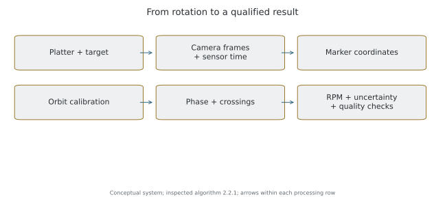
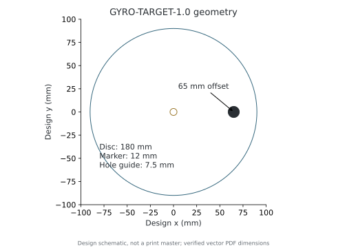
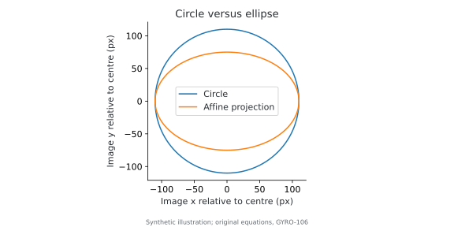
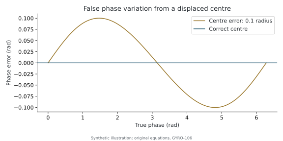
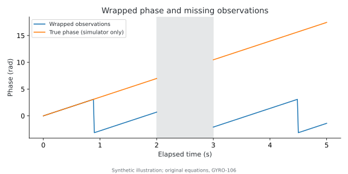
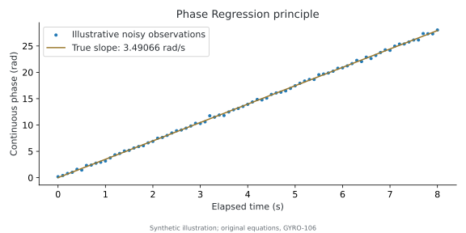
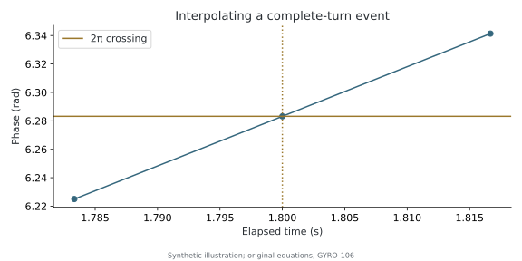

# Optical Measurement Methodology

Gyro Analyzer measures average rotational speed by observing one marker on a turntable with a stationary Android phone. It measures the relationship between orbital position and camera time, without putting the phone on the platter. This paper describes the inspected development implementation, not a certified instrument.

**Baseline:** application `1.0.0-stage1b`, version code 10; algorithm `2.2.1`; verification 2026-11-05. Historical CSV algorithm identifiers differ. Conditions and numerical outputs are recorded in [validation evidence](publication-evidence.md). The Android implementation remains proprietary.

## 1. Scope and system

Average RPM helps reveal sustained speed offset and monitor adjustment. Wow and flutter concern speed variation over specified frequency bands and require appropriate sampling, filtering and reference procedures. A precise average does not demonstrate low wow and flutter. No standardized wow-and-flutter measurement is claimed here.



*Figure 1. Original conceptual system diagram; no experimental data.*

The platter carries a target. The camera supplies images and timestamps. Detection produces image coordinates, calibration maps coordinates to phase, and estimators relate phase to time. Quality checks can invalidate a number even when arithmetic produces it. Nominal 33⅓ or 45 RPM is a comparison reference, not a fitting constraint.

## 2. Official optical target

The [A4 PDF](../targets/gyro-optical-target-a4.pdf) and [Letter PDF](../targets/gyro-optical-target-letter.pdf) implement **GYRO-TARGET-1.0**. Actual vector paths, page dimensions, metadata and checksums were checked.

| Feature | Design dimension | Meaning |
| --- | --- | --- |
| Working disc | 180 mm diameter | Fits A4 and Letter |
| Black marker | 12 mm diameter | One marker on white paper |
| Marker offset | 65 mm | Centre-to-centre distance |
| Spindle-hole guide | 7.5 mm diameter | Initial cutting guide, not universal spindle-fit approval |
| Control line | 50 mm | Measure after printing at actual size |



*Figure 2. Design schematic in millimetres; not a printable target.*

Print at 100%, disable fit-to-page, measure the control line and use opaque flat paper. The preparation guide's 1% print-scale criterion is not an RPM accuracy claim. Uniform scale does not directly set RPM because the calculation uses angle rather than linear distance. Distortion, curling, shadows, eccentric mounting and spindle interference can nevertheless impair observation or rotation. Stop the platter before installation; see [target preparation](target-preparation.md).

One marker avoids ambiguous multiple passages per turn. The printed centre locates the intended mounting hole; the actual centre of rotation is estimated from motion. They need not coincide. Historical experimental green-marker recordings do **not** physically validate the official black-marker design. Four new physical sessions with the official black target now provide initial field evidence; broader printer/device acceptance remains incomplete. See the real-world validation subsection below.

See [versions](../targets/versions.json) and [SHA-256 checksums](../targets/SHA256SUMS.txt). Modified targets have not passed official compatibility validation unless separately documented. The Official Gyro Optical Target designation is not an absolute-accuracy certification.

## Official Optical Target — Real-World Validation

**Observed in real measurements:** the owner supplied four algorithm-2.2.1 recordings on a Michell Gyro SE using the official printed black-marker GYRO-TARGET-1.0 target. The sequence was **Unloaded → Playback → Playback → Unloaded**. Unloaded means tonearm and stylus not engaged; it does not specify an otherwise identical mechanical load. Target identity, operating condition and use of automatic calibration are owner-reported; the CSV does not store the target version or exact application build. It does store geometry, calibration checks and RPM results. These records are separate from the earlier experimental green-marker collection.

The actual A4 and Letter vector geometry and checksums were rechecked: working diameter 180 mm, black mark 12 mm, offset 65 mm and spindle-opening guide 7.5 mm. The PDFs are deliberately designed for automatic acquisition and orbit calibration. One high-contrast marker simplifies identity and one-turn interpretation; it does not guarantee that segmentation will find only one candidate in the entire camera image.

### Implemented automatic-calibration acceptance

Source inspection, rather than interpretation of status labels, establishes this sequence:

1. Acquire timestamped YUV frames; requested 60 FPS is distinct from delivered/processed cadence.
2. Segment dark or supported legacy-colour pixels. Screen connected components by size, elongation (at most 2.2), fill (0.50–0.92) and a bright surrounding ring (at least 13 of 16 samples).
3. Associate candidates through time using position, area and marker mode; reject ambiguous associations and expire stale tracks.
4. Accumulate at least 60 points over at least two seconds; retain a bounded recent orbit history.
5. Fit robust circle/ellipse geometry. Acquisition requires radius/marker-diameter ratio 3.0–8.5, fit residual at most max(1.5 px, 0.015 radius) and inlier confidence at least 0.9.
6. Require three consistent fits: centre change below 1.2 px and each axis change below 1.5 px. More than one ready track or another plausible moving candidate prevents lock.
7. Select the locked marker and independently validate spatial observations in three-second windows. A sufficient window has at least 60 observations covering 10 of 12 phase bins. Tolerance is max(1.5 px, 4 × max(0.35 px, fit residual)); no more than 35% may lie outside it for VALIDATED. Three sufficient failing windows invalidate geometry; insufficient coverage is VALIDATING, and prolonged absence of evidence becomes unverified.
8. Official-target readiness requires accepted validation. Precision-start checks also require usable geometry and current observations; readiness is not a timer-only decision.

All four recordings end with `calibration_validation = VALIDATED`. In M01, 2,321 earlier rows are VALIDATING and 6,194 are VALIDATED; the other three retain VALIDATED throughout their exported rows. These files start after acquisition, so first-attempt count, unsuccessful attempts and time-to-lock are unavailable. Accepted calibration proves that the implemented checks accepted those observations, **not that geometric error is zero** or that every possible accepted calibration is correct.

### Field model selection and tracking

M01/M03/M04 use CIRCLE; M02 uses ELLIPSE_AFFINE. The selector returns a circle immediately when its residual is below 0.35 px. Otherwise it tests a robust ellipse; a nearly circular ellipse (minor/major axis ratio above 0.995) does not justify extra parameters when a circle is available. Alternating training/validation points must show ellipse median spatial error below 65% of the circle error, with the training ellipse centre consistent with the full ellipse. Fit failure can fall back to a circle. Neither model name is a quality ranking.

The saved models are fixed throughout these recordings. The pre-recording candidate points and competing fit scores are not exported, so the exact selection branch for an individual session cannot be replayed from these files. M02's accepted ellipse and the other accepted circles are consistent with the implemented choices; the files do not independently prove why every alternative lost. The original circle/ellipse and displaced-centre diagrams in section 5 explain the geometric consequences.

Valid exported-row coverage is M01 63.993%, M02 99.921%, M03 89.624% and M04 93.631%. Illumination, reflections, thresholding, background regions, camera position and processing can affect observations. The CSV alone does not identify which physical cause dominated a loss.

`COMPETING_MARKERS` means the tracker found additional surviving candidate components whose area exceeds 60% of the best candidate's area. A near-tie in distance (under 8 px difference) lowers confidence to 0.25 and fails the measurement confidence gate of 0.4. A more distant extra component can set the flag while the best observation remains accepted. Components are image regions, not a count of confirmed physical markers. Area, temporal association, brightness, geometry and phase gates reject unsuitable observations. Without diagnostic images, assigning candidates to the spindle hole, reflection or a specific background object would be speculation.

### Tracking segments, phase blocks and windows

| Session | Segment IDs | Valid runs | Phase blocks | Global-phase values | Geometry residual px | COMPETING_MARKERS rows |
| --- | --- | --- | --- | --- | --- | --- |
| M01 | 191 | 190 | 3 | 1 | 0.242936 | 4232 |
| M02 | 2 | 2 | 1 | 10174 | 0.203028 | 5338 |
| M03 | 165 | 165 | 1 | 9139 | 0.560231 | 7919 |
| M04 | 134 | 134 | 1 | 9556 | 0.337985 | 8440 |

Segment IDs count interruption state changes; a phase block changes only when the turn continuation is ambiguous or explicitly broken. Short recovered losses can therefore create many tracking segments while preserving one phase block. The number of valid runs is an independently counted number of contiguous accepted-row sequences. M01 has 191 exported IDs but only 190 valid runs: its last segment contains no accepted observation. Calling all 191 IDs successful tracking runs would be incorrect.

M01 has one accepted point in block 0, 625 in block 1 and 4,823 in block 2. New blocks start at 0.267177 s and 28.586260 s with phase-ambiguity flags. `global_unwrapped_theta` is intentionally exported only for valid observations in block 0. Thus only one M01 row contains it. Every row in all four files follows this rule exactly; no serialization defect is demonstrated. Local `unwrapped_theta_rad` remains available in later blocks, and fixed-intercept-per-block regression estimates RPM without asserting unknown global turns.

An RPM window is a time interval selected for a fit, not a tracking segment or a phase block. It can include several supported pieces with independent phase origins. Predictions are never added as observations. The [field results and limits](accuracy-and-uncertainty.md#field-validation-with-the-official-optical-target) quantify these distinctions.

## 3. Camera acquisition and timing

CameraX supplies YUV 420 888 images with keep-only-latest backpressure. Current defaults request 640 × 480 and 60 FPS. Requests are negotiation inputs, not delivery guarantees. Supported ordinary capture ranges determine selection; a dedicated high-speed YUV path is not implemented. Selecting 120 FPS does not establish 120 delivered or processed observations per second.

Capture FPS describes actual exposures; processed FPS describes frames reaching analysis. Backpressure can discard frames and tracking can reject others. The measurement uses `ImageInfo.timestamp` in nanoseconds. The timestamp origin is subtracted before conversion to floating-point seconds. Time is never frame number divided by nominal FPS.

The audit checks non-negative, strictly increasing timestamps and, where available, matching capture metadata, exposure, frame duration and rolling-shutter metadata. Missing metadata leaves the timebase uncalibrated. Arrival time is operational monitoring information, not the measurement clock.

Android specifies sensor time as the exposure start of the first sensor row. No calibrated midpoint-exposure or row-dependent rolling-shutter correction is applied. Constant offset changes an intercept; varying exposure or row timing can change phase and slope. Stabilization is requested off, which alone does not prove device behaviour. See [CameraX analysis](https://developer.android.com/media/camera/camerax/analyze) and [sensor timestamp](https://developer.android.com/reference/android/hardware/camera2/CaptureResult#SENSOR_TIMESTAMP).

## 4. Detection and tracking

Automatic acquisition operates directly on YUV planes, segmenting dark regions with support for legacy green regions. Four-connected components are screened by size, shape, fill and surrounding brightness. Candidate tracks are associated by movement and area. Acceptance requires orbital motion, plausible geometry and repeated stable fits with high heuristic confidence. Competing moving candidates prevent acceptance; a stationary black spot is insufficient.

Manual tracking can learn a small selected image patch, then use chroma or dark-intensity matching. Region-of-interest segmentation identifies components; a full-resolution weighted centroid estimates position. Area, elongation, ambiguity and photometric tests affect confidence. Confidence is a heuristic score, **not a calibrated probability**.

Prediction helps locate the next candidate but is never treated as an observed coordinate. Loss reduces coverage. Recovered observations must pass geometry and phase checks; unknown whole turns are not fabricated to fill a gap. Automatic acquisition removes small tap targets from setup, not the need for contrast and a fixed camera.

## 5. Circle and affine ellipse calibration

A circular orbit viewed obliquely generally appears elliptical. The implementation uses a centred algebraic circle solution within deterministic RANSAC, residual refinement and angular-coverage checks. An ellipse candidate uses a normalized conic fit, robust sampling and held-out comparison with the circle. Minimum point counts, axes, inlier fraction, angular distribution and normalized residuals are checked. Solving a conic through a few points is insufficient.

Ellipse selection requires substantial held-out residual improvement and a compatible centre. Geometry changes need repeated consistent proposals. Independent off-orbit observations can invalidate accepted calibration; lack of observations leaves it unverified. Moving the camera requires recalibration. Geometric residuals do not measure camera-clock accuracy.



*Figure 3. Synthetic image geometry in pixels.*

For image point (x,y), centre (cx,cy), semiaxes a,b and orientation φ:

```text
u = ((x − cx) cos φ + (y − cy) sin φ) / a
v = (−(x − cx) sin φ + (y − cy) cos φ) / b
θ = atan2(v,u)                            [rad]
```

A circle has a = b. `ELLIPSE_AFFINE` is affine normalization, **not complete projective camera calibration**, lens calibration or a camera-pose solution. Strong perspective and lens distortion may leave systematic errors.



*Figure 4. Synthetic unit-circle example: centre displaced by 0.1 radius produces periodic phase error despite constant physical speed.*

## 6. Phase reconstruction

Wrapped angle covers one revolution. Unwrapping selects a nearby continuation using recent phase motion. Within a continuous block:

```text
θ(t) = θ0 + ωt + ε(t)
```

θ0 is phase origin; ω is angular speed in rad/s; ε includes localization, geometry error and real departures from constant speed. Gaps longer than two seconds or ambiguous continuations start new blocks. Global phase is not asserted across unknown lost turns. Regression gives separate intercepts to discontinuous blocks; crossing epochs likewise avoid inventing inter-block revolution counts.



*Figure 5. Synthetic example in seconds and radians. Missing observations do not establish a turn count across the gap.*

## 7. Phase Regression

Fits use observed timestamps and accepted coordinates. Low confidence, excessive blur, inadequate light, off-orbit motion and handheld operation can reject observations or invalidate quality. Nonuniform sampling is represented by actual time values.

Let x_i and y_i be time and phase after subtraction of their weighted means within each continuity block:

```text
ω_hat = Σ w_i x_i y_i / Σ w_i x_i²
RPM_phase = |ω_hat| × 60 / (2π)
```

Three iteratively reweighted passes use residual scale max(0.0005 rad, 1.4826 × median absolute residual) and weights min(1, 2.5 × scale / max(10⁻¹², |residual|)). This is robust reweighting, not ordinary least squares relabelled as robust. It reduces outlier influence but cannot remove shared systematic error.

A numerical fit needs 12 observations and two seconds. Reliable-window status also requires adequate duration, coverage, residual control and at least three eligible uncertainty blocks. Computability alone is insufficient; see [uncertainty](accuracy-and-uncertainty.md).



*Figure 6. Synthetic explanatory phase observations and linear trend; not an additional application benchmark.*

## 8. Revolution Timing

The second estimator locates integer multiples of 2π in the rotation direction. For adjacent observations bracketing θk:

```text
f = (θk − θa) / (θb − θa)
tk = ta + f (tb − ta)                     [s; stored as rounded ns]
```

Crossings require the same continuity block, compatible direction and positive elapsed time no greater than 0.25 s. Gaps and implausible jumps reset epochs. Both directions are supported; RPM is a non-negative magnitude. Unknown turns across epochs are not counted.

The endpoint diagnostic is 60N/(tN−t0), with N supported complete turns. The primary estimator instead fits:

```text
tk = α_group + k T + error_k
RPM_revolution = 60 / T_hat
```

Groups have separate intercepts and a common positive period. Eligible groups need three events and there must be at least four overall. Four robust passes reduce crossing-time outlier influence. Interrupted data contribute supported within-group timing, not fictitious bridges. Endpoint and fitted-period results need not coincide.



*Figure 7. Synthetic crossing neighbourhood. Sub-frame interpolation assumes locally linear phase; it does not improve absolute clock calibration.*

## 9. Estimator agreement

Phase Regression uses many angles; Revolution Timing uses supported complete-turn events. Comparison restricts phase fitting to supported crossing intervals. Paired block differences and an autocorrelation-aware 99% limit assess consistency. Drift, invalid geometry, insufficient blocks or disagreement override a numerical match.

Both methods share timestamps, coordinates, geometry and phase. They are mathematically distinct but statistically dependent. **Agreement is a consistency check, not absolute calibration.** A common clock-scale error can bias both almost identically.

## 10. Worked examples

### Ideal simulated rotation

At 33⅓ RPM, ω = 10π/9 = 3.490658504 rad/s and T = 1.8 s. At 60 observations/s the ideal phase increment is 0.058177642 rad. Sixty turns span 108 s: 60 × 60/108 = 33.333333333 RPM. Phase conversion 60ω/(2π) agrees. Twelve implementation tests cover 33⅓/45 RPM, 30/60/120 FPS and both directions over 65 s; both estimators satisfy a 10⁻⁸ RPM numerical tolerance. This validates arithmetic, not physical accuracy.

### Field example M02: excellent coverage, changing block speed

The playback recording spans 180.011146 s and accepts 10,174 of 10,182 rows (99.921%). It uses ELLIPSE_AFFINE, two segment IDs and one phase block, ending with VALIDATED calibration and RELIABLE_MODEL all-history quality. At the last exported updates, Phase Regression gives 33.237167164 RPM, Revolution Timing 33.236674421 RPM and the all-history result 33.237261751 RPM. The all-history result uses all accepted phases to its update time; the paired methods use common supported crossing intervals. They need not equal each other.

Independent Python code reconstructs the three-pass weighted, block-centred phase slope and the four-pass crossing-time regression from accepted exported phase/time observations. It reproduces all three numbers within 10⁻⁹ RPM. The unchanged Kotlin source also reproduces their conditional uncertainty fields. High tracking coverage does not establish stationary rotation: the first independent 30-second fit is 33.307267 RPM, followed by 33.239440 RPM, with later blocks nearer 33.23 RPM. The cause is not isolated by these data.

### Field example M01: interrupted tracking with usable local phase

The unloaded recording spans 147.312761 s and accepts 5,449 of 8,515 rows (63.993%). It uses CIRCLE, 191 exported segment IDs (190 accepted runs) and three phase blocks. Final calibration is VALIDATED, all-history quality is RELIABLE_MODEL, and the paired status is METHODS_CONSISTENT_ABSOLUTE_UNKNOWN. Earlier low-coverage and unreliable states remain part of the record.

The last exported Phase Regression result is 33.260638153 RPM, Revolution Timing 33.260723459 RPM, and all-history RPM 33.260559648. Independent fitting reproduces all three within 10⁻⁹ RPM despite only one populated global-phase row: local phase plus block-specific intercepts is sufficient. The first 30-second interval has only 38.933% accepted-row coverage; the final 27.313-second interval is partial. Both are visibly flagged in the field chart, not treated as ordinary full accepted blocks.

### Export time versus finalization

These examples reproduce the **last values exported in the CSV**, matching the supplied checkpoints. All-history fits refresh about once per second; paired estimates refresh about every five seconds. The last rows therefore contain cached fits ending slightly earlier than the recording. The reconstruction uses the last change of each result field to locate its corresponding prefix. Post-stop finalization can write newer results to companion JSON without adding a final CSV row; no companion JSON was supplied. The examples must not be described as verified post-stop JSON summaries. See [aggregate evidence](field-validation-results.json) for update times and independently calculated results.

## 11. Limitations and references

Clock scale, rolling shutter, varying exposure, marker bias, affine-model limitations, printing, lighting and blur can produce systematic error. Lost frames reduce evidence and can make phase ambiguous. Real drift violates a constant-speed model. Longer records reduce some statistical effects but do not cancel all biases.

Average-speed estimation and internal diagnostics are demonstrated under stated conditions. Certified or traceably calibrated absolute accuracy is not established. Continue with [accuracy and uncertainty](accuracy-and-uncertainty.md), [numerical evidence](publication-evidence.md), [physical protocol](physical-test-protocol.md) and [documentation index](index.md).

Copyright 2026 Sergey Kravchinskiy. Documentation and original explanatory figures: CC BY 4.0. Branding remains all rights reserved; Android application and source code remain proprietary. See [license scope](../LICENSE.md).
